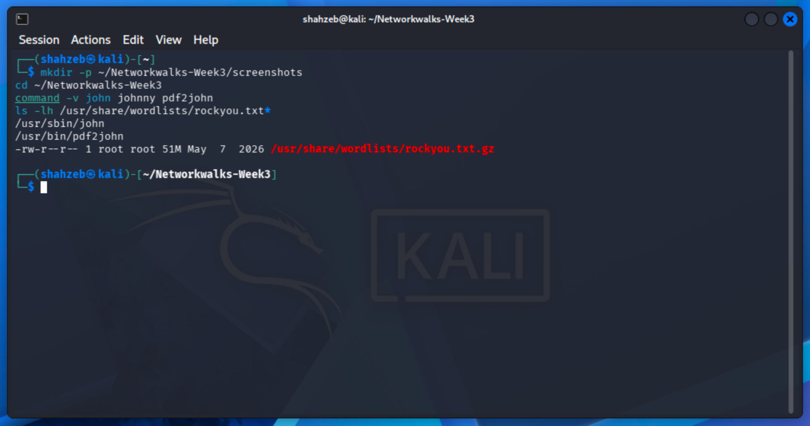
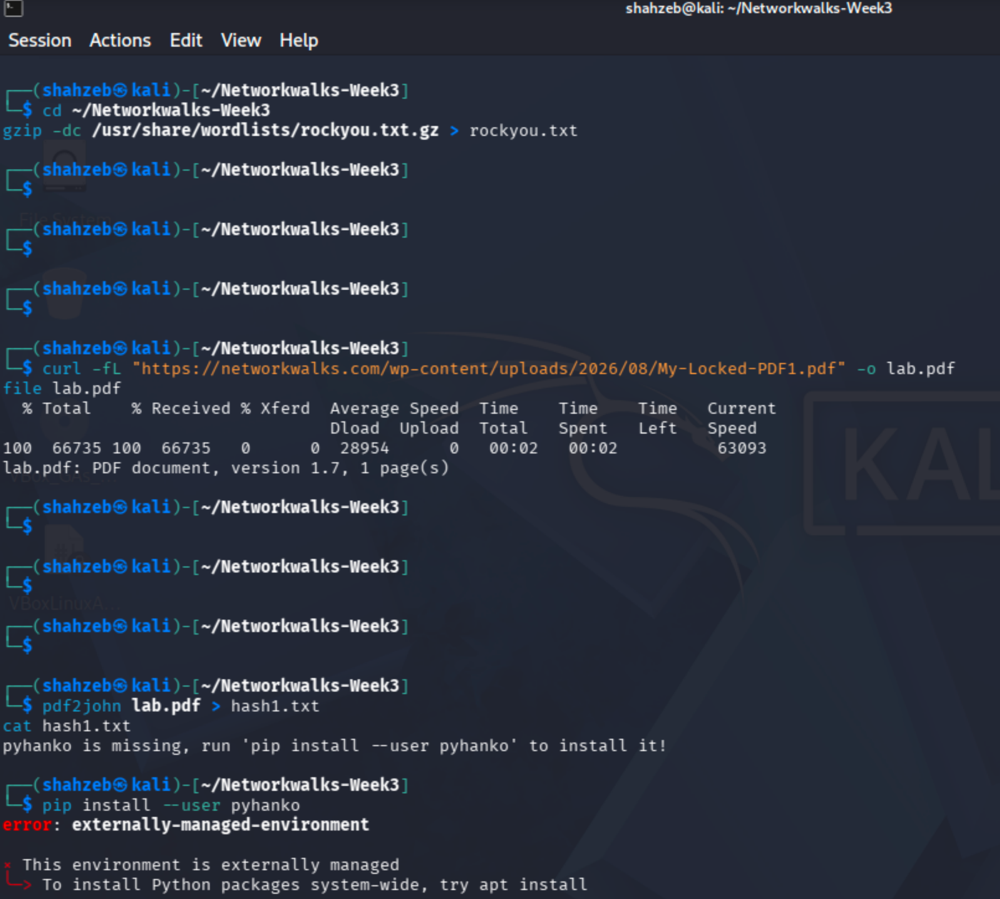
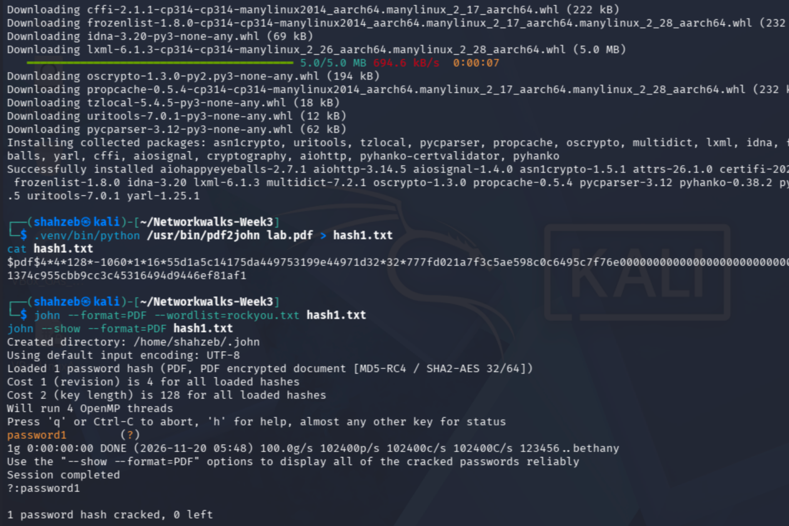
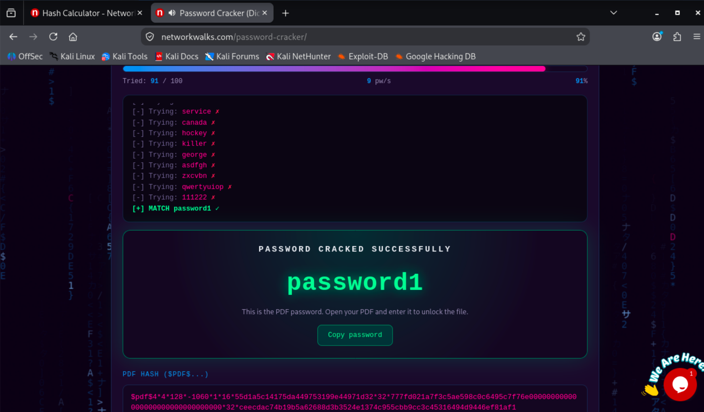

# 🔐 Week 03 — Password Recovery with John the Ripper & Networkwalks Tools

**Shahzeb Ali · Batch B084 · Networkwalks Cybersecurity & Ethical Hacking Internship**

| Project detail | Description |
| --- | --- |
| Modules | W3-PM1: Password Cracking with JTR; W3-PM2: Password Cracking with NW Tools |
| Lab date | 20 November 2026 |
| Environment | Kali Linux virtual machine on a Mac |
| Target | Networkwalks training document `My Locked PDF1.pdf`, saved locally as `lab.pdf` |
| Method | Offline dictionary-based password recovery |
| Outcome | Both tools recovered `password1`; the PDF was opened successfully |

## 🎯 Project Overview

This project documents password recovery on a password-protected PDF supplied for the Networkwalks training lab. I extracted the PDF's password-verification data, tested candidate passwords using two toolsets, and verified the recovered password by opening the document.

The practical work covered:

- **Activity 1:** Local extraction with `pdf2john` and a dictionary attack using John the Ripper.
- **Activity 2:** Extraction with the Networkwalks Hash Calculator and recovery using the Networkwalks Password Cracker.
- Troubleshooting a missing Python dependency and a failed dictionary attempt.
- Recording terminal output, browser results, and the unlocked document.

**Implementation note:** Activity 1 was performed using John's command-line interface on Kali Linux. Johnny GUI was not used.

## 🛠️ Tools Used

| Tool | Purpose |
| --- | --- |
| Kali Linux | Lab operating system |
| John the Ripper | Test password candidates against extracted PDF data |
| `pdf2john` | Convert PDF encryption and verification data into a format John can process |
| `rockyou.txt` | Wordlist for the local dictionary attack |
| Python virtual environment and `pyhanko` | Provide the missing PDF parsing dependency |
| Networkwalks Hash Calculator | Extract PDF verification data in the browser |
| Networkwalks Password Cracker | Perform the browser-based dictionary attack |
| Firefox and a PDF viewer | Access the tools and verify the recovered password |

## 📂 Repository Contents

This report includes five original screenshots in the folders below. Keep these folders alongside `README.md` when uploading to GitHub so all images render correctly.

| Path | Contents |
| --- | --- |
| `README.md` | This report |
| `activity-01-kali-terminal/01-tool-check.png` | Installed tools and compressed wordlist |
| `activity-01-kali-terminal/02-dependency-error.png` | Missing dependency and Python installation error |
| `activity-01-kali-terminal/03-password-recovered.png` | Successful extraction and John output |
| `activity-01-kali-terminal/04-pdf-unlocked.png` | Opened PDF and first flag |
| `activity-02-web-tools/02-password-recovered.png` | Successful browser result |

## 💻 Activity 1 — Password Recovery with John the Ripper

### 1. Prepare the workspace and check the tools

```bash
mkdir -p ~/Networkwalks-Week3/screenshots
cd ~/Networkwalks-Week3
command -v john johnny pdf2john
ls -lh /usr/share/wordlists/rockyou.txt*
```

The tool check located John at `/usr/sbin/john` and `pdf2john` at `/usr/bin/pdf2john`. The wordlist was available as `rockyou.txt.gz`. Johnny was not found by this check.



### 2. Extract the wordlist and download the practice PDF

```bash
gzip -dc /usr/share/wordlists/rockyou.txt.gz > rockyou.txt

curl -fL "https://networkwalks.com/wp-content/uploads/2026/08/My-Locked-PDF1.pdf" -o lab.pdf
file lab.pdf
```

The file check identified a **PDF document, version 1.7, with one page**.

### 3. Resolve the extraction dependency

The initial extraction attempt failed:

```bash
pdf2john lab.pdf > hash1.txt
```

The error reported that `pyhanko` was missing. An attempt to install it using `pip install --user pyhanko` then produced an `externally-managed-environment` error.

I created a virtual environment and installed the dependency inside it:

```bash
sudo apt install -y python3-venv
python3 -m venv .venv
.venv/bin/python -m pip install pyhanko
```

This allowed the extraction script to run with its dependency available in the project's Python environment.



### 4. Extract the PDF verification data

```bash
.venv/bin/python /usr/bin/pdf2john lab.pdf > hash1.txt
cat hash1.txt
```

The output began with `$pdf$`, confirming that the extractor produced a PDF record for John to process.

The PDF record contains encryption parameters and password-verification data. It is not a plain MD5 or SHA checksum of the whole file.

### 5. Run the dictionary attack

```bash
john --format=PDF --wordlist=rockyou.txt hash1.txt
john --show --format=PDF hash1.txt
```

John loaded one PDF password record and recovered:

```text
password1

1 password hash cracked, 0 left
```



### 6. Verify the result

```bash
xdg-open ~/Networkwalks-Week3/lab.pdf
```

I entered `password1` in the PDF viewer. The document opened and displayed the congratulations page and first flag:

```text
nw{networkwalks_flag1_jtr_270521_1}
```


## 🌐 Activity 2 — Password Recovery with Networkwalks Web Tools

### 1. Extract the PDF data

I opened the [Networkwalks Hash Calculator](https://networkwalks.com/hash-calculator/), selected its **PDF** tab, and chose the training document. I copied the complete output beginning with `$pdf$`.

### 2. Investigate the initial unsuccessful attempt

The initial input had a different PDF identifier from the file tested in Kali. The browser tool tested all **100 candidates** in its wordlist and reported:

```text
Exhausted wordlist. No match.
```

| Attempt | PDF identifier |
| --- | --- |
| Initial unsuccessful browser input | `ca7f72f11459cba469f1005a8765ed51` |
| Verified training PDF used in Kali and the successful browser attempt | `55d1a5c14175da449753199e44971d32` |

This established that the two attempts were using different PDF records. The failed attempt did not demonstrate that the verified training PDF resisted the dictionary attack.

### 3. Recover the password using the verified PDF record

I selected the same training PDF used in Activity 1, extracted its data again, and pasted the complete record into the [Networkwalks Password Cracker](https://networkwalks.com/password-cracker/).

The tool displayed:

```text
Tried: 91 / 100
[+] MATCH password1
PASSWORD CRACKED SUCCESSFULLY
```

The successful browser attempt used the **100-entry wordlist**; loading the larger RockYou wordlist into the browser was unnecessary.



The result matched John's recovered password. Its validity for this PDF had already been confirmed by opening the document in Activity 1.

## 📊 Results

| Test | Result |
| --- | --- |
| PDF download and format check | Valid one-page PDF identified |
| Local extraction | Successful after installing `pyhanko` in a virtual environment |
| John dictionary attack | `password1`; one hash recovered, zero left |
| PDF verification | Document opened and first flag displayed |
| Initial browser attempt | Different PDF record; 100 candidates exhausted without a match |
| Browser attempt using the verified record | `password1` recovered after 91 candidates |

## 🔧 Troubleshooting Summary

| Issue | Evidence | Resolution or interpretation |
| --- | --- | --- |
| Wordlist was compressed | `rockyou.txt.gz` present | Extracted a local copy with `gzip -dc` |
| Missing PDF parsing dependency | `pyhanko is missing` | Installed `pyhanko` inside a virtual environment |
| User-level pip installation blocked | `externally-managed-environment` | Used the virtual environment's Python and pip |
| Browser dictionary attempt failed | No match after 100 candidates | Compared PDF identifiers and repeated the test using the verified training PDF |
| Johnny unavailable | No path returned by `command -v` | Completed the local activity through John's CLI |

## 📚 What I Learned

- Dictionary attacks succeed when a matching password is among the tested candidates.
- A failed wordlist attempt establishes only that the tested candidates did not match that input.
- Selecting the correct file and preserving the complete extracted record are essential for reproducible results.
- PDF encryption alone does not compensate for a predictable password.
- Python virtual environments help resolve dependencies without mixing project packages into the system Python environment.
- Opening the protected document with the recovered password provides practical verification.
- Clear screenshots and documented troubleshooting make a lab report easier to review.

## ✅ Conclusion

Both John the Ripper and the Networkwalks browser tool recovered `password1` for the same training PDF. Opening the PDF confirmed the result and revealed the first flag.

The exercise demonstrated offline dictionary-based password recovery, dependency troubleshooting, input verification, and evidence collection. It reinforced the value of long, unique, randomly generated passwords for protecting encrypted documents.

## 🔗 References

- Networkwalks, **W3-PM1 — Password Cracking with JTR**, supplied assignment sheet.
- Networkwalks, **W3-PM2 — Password Cracking with NW Tools**, supplied assignment sheet.
- [Official JTR lab page](https://networkwalks.com/password-cracking-with-jtr-john-the-ripper-project-task-lab/)
- [Official Networkwalks tools lab page](https://networkwalks.com/password-cracking-with-networkwalks-tools-project-task-lab/)
- [John the Ripper — Openwall](https://www.openwall.com/john/)
- [Kali guidance on Python external packages](https://www.kali.org/docs/general-use/python3-external-packages/)
- [Reference repository consulted for organization](https://github.com/GhostAI20/NETWORKWALKS-NADUNI-UMEDA-B084-WK3-Password-Cracking-JTR)

---

**Scope:** This report covers the Networkwalks training PDF used in this educational lab. All reported results are based on the screenshots captured during my own practical work.
